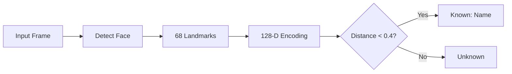

# Face Recognition Using Deep Learning

Real-time face recognition system that identifies people from **images, videos, live camera and CCTV** using a deep learning (ResNet) embedding pipeline. It supports **1:1, 1:N, N:1 and N:N** matching, and new people can be added **without retraining**.

> B.Tech Project · ECE, NSUT Delhi · Guided by Prof. Arti M.K.

---

## Problem

Most existing open-source face recognition projects:
- support only **one matching mode**
- **can't handle live video** well
- take **one input source** only
- need **retraining** to add a new person
- are **not tested** in low light or with masks

This project solves all of these in one system.

---

## Features

| Feature | Details |
|---|---|
| **Multi-mode matching** | 1:1 verify · 1:N identify · N:1 · N:N (everyone in a frame) |
| **Multiple inputs** | Image, video file, webcam, CCTV stream |
| **Real-time** | Frame-by-frame recognition on live feed |
| **No retraining** | New person = just store their face encoding |
| **Real-world tested** | Normal light, low light, masked faces |

---

## How It Works

1. **Detect** the face in the image / frame
2. **Align** it using 68 facial landmarks (eyes, nose, mouth, jaw)
3. **Encode** it into a 128-D vector with dlib's pretrained ResNet
4. **Compare** with stored vectors. Distance below **0.4** means match

**Why 0.4?** Lower is stricter (fewer wrong matches) and higher is lenient (fewer rejections). 0.4 is a strict setting suited to security use.

---

## Models

| Model | Role |
|---|---|
| `shape_predictor_68_face_landmarks` | Finds 68 key points to align the face |
| `dlib_face_recognition_resnet_model_v1` | Converts face to a 128-D embedding (~99.3% on LFW benchmark) |

---

## Challenges

| Challenge | Approach |
|---|---|
| Low light | Illumination normalisation in pre-processing |
| Slow video FPS | Faster inference, GPU acceleration |
| Masked faces | Analysed performance; masked-face datasets as next step |

---

## Tech Stack

`Python` · `dlib` · `OpenCV` · `NumPy`

---

## Future Scope

- Liveness detection to block photo/screen spoofing
- Fine-tuning on masked-face datasets
- Vector database for large-scale search
- REST API + Docker deployment

---

## Team

- **Harshit Kumar**
- **Shrey Soni**

**Supervisor:** Prof. Arti M.K., Department of ECE, NSUT
